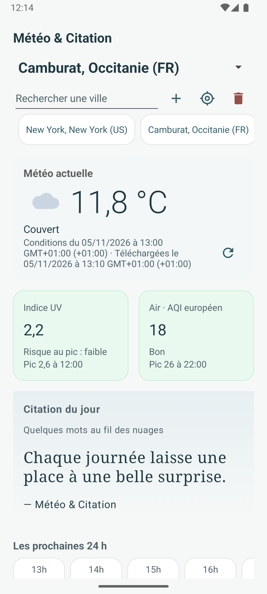

# Météo & Citation (Android, Kotlin)

Application Android de météo : **conditions actuelles**, **prévisions horaires**, **7 prochains jours** et **citation quotidienne**, avec consultation hors ligne et widget d’accueil.

Version déclarée dans le dépôt : **7.4** (`versionCode = 22`). Compatible à partir du SDK 24 ; compilation et cible SDK 36.

[](https://github.com/Arckanna/MeteoQuote/actions/workflows/android.yml)



Capture de la version 7.4 sur émulateur Android, réalisée le 5 novembre 2026.

## Fonctionnalités

- Température et conditions, prévisions sur **24 h** et jusqu’à **7 jours à partir de demain**, selon les données disponibles et le fuseau de la ville.
- **Indices UV et qualité de l’air (AQI européen)**, avec pics de la journée. L’AQI est facultatif : son indisponibilité ne masque pas la météo.
- Recherche via Open-Meteo Geocoding : jusqu'à cinq villes avec région et pays, ajout après choix explicite, chargement annulable et saisie conservée en cas d'erreur. Villes enregistrées et liste des récents. **Ma position** utilise une permission de localisation approximative facultative ; la recherche manuelle fonctionne sans cette permission.
- **Citation quotidienne** conservée selon la date locale du téléphone, commune à l’application et au widget et stable lors des changements de ville.
- **Consultation hors ligne** après un premier chargement, avec dates des données et indication des conditions anciennes.
- **Widget redimensionnable** affichant la ville sélectionnée dans l’application, la météo, la citation et une action d’actualisation.
- **Icônes couleur et ambiance visuelle** adaptées à la météo.
- **Envoyer un retour** via Google Forms, avec version de l’application, système et modèle du téléphone préremplis.

## Fiabilité et cache

La recherche est pilotée par le ViewModel. Une nouvelle saisie, une sélection manuelle ou une demande de localisation invalide les résultats précédents : une réponse tardive ne remplace pas le dernier choix et n’efface pas une nouvelle saisie.

Les boutons visibles **Ma position** et **Gérer mes villes** donnent accès à la localisation et aux villes enregistrées. Le dialogue de gestion permet de choisir une ville ou de la supprimer après confirmation. La suppression vise ses coordonnées, jamais sa position dans la liste, et conserve au moins une ville. Ses actions sont empilées et la liste peut défiler.

Le cache météo Room est conservé par lieu : fraîcheur de récupération de **30 minutes**, indicateur de cache ancien à partir de **24 heures**, expiration à **7 jours**. L’heure des conditions fournies reste distincte de l’heure de téléchargement : le titre « Météo actuelle » exige des conditions datées de moins d’une heure et des dates cohérentes. Le cache AQI est indépendant.

Les rendus du widget sont mis en file pour conserver les demandes reçues pendant une mise à jour. Un rendu demandé par l’application lit uniquement le cache, même sans réseau. Les téléchargements sont séparés par lieu : les demandes automatiques partagent le travail en attente et revérifient la fraîcheur à l’exécution ; une demande forcée est prioritaire. Les échecs automatiques météo et AQI déclenchent une temporisation indépendante par lieu, de 1 à 15 minutes.

## Stack

- **Kotlin**, coroutines, **ViewModel / StateFlow** et injection **Hilt**.
- Interface hybride : **Views/XML** et **Jetpack Compose Material 3** pour la citation ; gestion des marges système avec WindowInsets.
- Météo, géocodage et AQI **Open-Meteo**, transport **OkHttp**, décodage `org.json`.
- **Room** pour le cache météo/AQI ; **SharedPreferences** pour les villes, récents et citations.
- Widget **RemoteViews** et travaux persistants **WorkManager**.
- **Gradle Kotlin DSL**, Java 17 et desugaring `java.time` ; R8 et réduction des ressources en release.

## Build

Installer un **JDK 17** et le **SDK Android 36**. La CI installe également les Build Tools **35.0.0**. Utiliser le wrapper fourni (**Gradle 8.13**) ; les versions des dépendances sont centralisées dans [gradle/libs.versions.toml](gradle/libs.versions.toml).

Ouvrir le projet dans Android Studio ou configurer `JAVA_HOME` et l’emplacement du SDK (`ANDROID_HOME` ou `sdk.dir` dans un fichier local `local.properties`). Depuis la racine du dépôt, sous PowerShell :

```powershell
.\gradlew.bat assembleDebug
```

Sous Linux/macOS : `bash ./gradlew assembleDebug`.

APK de débogage : `app/build/outputs/apk/debug/app-debug.apk`.

Pour générer le bundle release : `./gradlew.bat bundleRelease` sous PowerShell. Le projet ne configure pas de signature de production ; la signature doit être réalisée avec la clé de publication existante.

> ⚠️ Ne pas versionner `*.jks`, `key.properties`, `local.properties`.

## Tests et intégration continue

```powershell
# Tests unitaires et analyse statique
.\gradlew.bat testDebugUnitTest lintDebug

# Compilation des tests Android
.\gradlew.bat assembleDebugAndroidTest

# Exécution sur un appareil ou un émulateur connecté
.\gradlew.bat connectedDebugAndroidTest
```

Les tests utilisent notamment JUnit, Robolectric, MockK, MockWebServer et les outils de test Room/WorkManager. Ils couvrent le cache, les erreurs réseau, les dates, les citations et les réponses concurrentes de recherche et de widget.

La [CI Android](.github/workflows/android.yml) exécute les tests unitaires et lint, construit les APK de débogage/tests et le bundle release, puis publie les rapports et artefacts. Elle exécute aussi **OfflineCacheTest** sur des émulateurs API **24 et 36** ; cette étape ne lance pas toute la suite instrumentée.

## Documentation

- [Index des guides, travaux ouverts et archives](docs/README.md)
- [Cache hors ligne : livraison et validation](docs/LOT_C_LIVRAISON.md)
- [Optimisation du widget et du réseau](docs/OPTIMISATION_WIDGET_RESEAU.md)
- [Widget compact et redimensionnement](docs/widget-compact.md)
- [Règles de la citation quotidienne](docs/lot-0-citation-quotidienne.md)
- [Migration progressive vers Compose](docs/migration-compose.md)
- [Injection de dépendances](docs/injection-dependances.md)
- [Revue du code du 2 novembre 2026](docs/REVUE_CODE_2026-11-02.md)
- [Cahier des charges et roadmap](docs/CAHIER_DES_CHARGES_ROADMAP.md)
- [Audit de modernisation Android](docs/ANDROID_MODERNIZATION.md)
- [Préparer une publication](docs/RELEASE.md)

Les guides ont été relus le 8 novembre 2026 ; les anciens audits et plans sont identifiés comme historiques dans l’index. La roadmap et la revue du code indiquent les corrections déjà livrées et les travaux encore ouverts. Pour une nouvelle livraison, vérifier la version déclarée dans [app/build.gradle.kts](app/build.gradle.kts) et reprendre la checklist de publication.

## Licence

[MIT](LICENSE)
