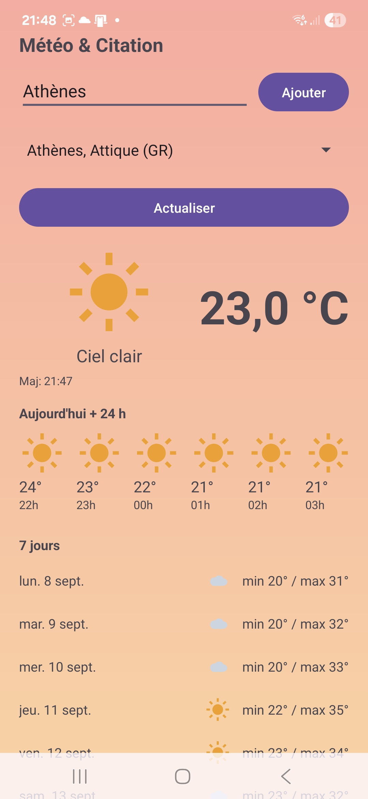

# Météo & Citation (Android, Kotlin)

App météo légère : **actuel**, **24 h**, **7 jours** + **citation** adaptée au temps.  
Recherche de villes (Open-Meteo Geocoding), persistance, **thème dynamique** (crossfade), bouton **Envoyer un retour**.

## Fonctionnalités
- Météo **actuelle**, **24 h** (heure par heure), **7 jours** (min/max)
- Recherche de villes + **persistance** (SharedPreferences)
- **Icônes couleur** + **thème** qui s’adapte à la météo (WMO → UI)
- **Citation quotidienne** persistée, commune à l’application et au widget
- **Consultation hors ligne** après un premier chargement, cache Room par lieu et données datées
- **Feedback** (Google Forms) avec infos techniques pré-remplies

## Stack
- **Kotlin**, Coroutines, Java 17 (desugaring `java.time`)
- **Android Views/XML**, WindowInsets (edge-to-edge Android 15)
- Réseau **Open-Meteo** (`OkHttp`), `org.json`
- Stockage météo **Room**, AQI indépendant et reprise réseau du widget
- **Gradle Kotlin DSL**, R8/ProGuard + shrink resources

## Build
- Android Studio **Narwhal 3** (JDK 17)
- `minSdk 24` / `targetSdk 36`
- Desugaring activée (`coreLibraryDesugaring`)
- Débogage local : `./gradlew assembleDebug`

> ⚠️ Ne pas versionner `*.jks`, `key.properties`, `local.properties`.

## Licence
[MIT](LICENSE)

## Modernisation Android 16

Audit : [docs/ANDROID_MODERNIZATION.md](docs/ANDROID_MODERNIZATION.md).
Procédure de publication et limites : [docs/RELEASE.md](docs/RELEASE.md).

Cache hors ligne et validation du lot C : [docs/LOT_C_LIVRAISON.md](docs/LOT_C_LIVRAISON.md).
